<p align="center">
  
</p>

# avenir-mcp: an unofficial MCP server for YNAB

<!-- mcp-name: io.github.mathbeal/avenir-mcp -->

**avenir-mcp** lets an AI agent read your YNAB plan and help you plan what comes next.

Unofficial, and listed by YNAB in its [Works with YNAB](https://api.ynab.com/#works-with-ynab-third-party) directory.

[English](https://avenir-mcp.pages.dev/avenir-mcp/) · [Français](https://avenir-mcp.pages.dev/avenir-mcp/fr/) · [Español](https://avenir-mcp.pages.dev/avenir-mcp/es/) · [Deutsch](https://avenir-mcp.pages.dev/avenir-mcp/de/) · [Nederlands](https://avenir-mcp.pages.dev/avenir-mcp/nl/)

[](https://api.ynab.com/#works-with-ynab-third-party)
[](https://pypi.org/project/avenir-mcp/)
[](https://pypi.org/project/avenir-mcp/)
[](https://github.com/mathbeal/avenir-mcp/actions/workflows/quality.yml)
[](https://www.bestpractices.dev/projects/15139)
[](https://github.com/mathbeal/avenir-mcp/blob/main/LICENSE)

<picture>
  <source media="(prefers-color-scheme: dark)" srcset="https://raw.githubusercontent.com/mathbeal/avenir-mcp/main/.github/assets/demo-dark.svg">
  
</picture>

[Watch the 20-second tour](https://avenir-mcp.pages.dev/avenir-mcp/#tour)

- **Read-only by default.** The tools that change your plan are registered only if you enable them.
- **Preview, confirm, undo.** A change is shown before it happens, confirmed by you, and can be undone.
- **Works with Claude Desktop, Claude Code, Cursor, VS Code, LM Studio and other MCP clients.**

## Features

- **Ask in plain language.** "Which category is overspent this month?", "Will I go below zero before December?", "When will my debts be paid off if I put 500 a month on them?"
- **Forecasts and plans.** `forecast_balance` projects the balance forward from scheduled transactions and recent spending; `get_runway` says how many months your money would last without income; `get_debt_payoff_plan` compares paying debts off by avalanche (highest interest first) or snowball (smallest balance first) order.
- **Classifies and reconciles.** `suggest_categories` proposes a category for each pending transaction from your own history; `reconcile_account` explains a gap with your bank before changing anything.
- **Finds what repeats.** `find_recurring_charges` lists subscriptions and recurring payments, ranked by their yearly cost.
- **One tool per task, not one call per endpoint.** Classifying a month, reconciling an account or building a forecast is a single tool call with typed, readable output.

Every tool, with a real answer: [Reference](https://avenir-mcp.pages.dev/avenir-mcp/reference/tools/) · [Use cases](https://avenir-mcp.pages.dev/avenir-mcp/guides/classify/).

## Quick start

You need a YNAB personal access token: YNAB → Account Settings → Developer Settings →
New Token.

[](https://github.com/mathbeal/avenir-mcp/releases/latest/download/avenir-mcp.mcpb)

**Claude Desktop**, no terminal: drop the file the button downloads onto **Settings →
Extensions**, then paste your token on that screen.

**Claude Code**, one command with your token in it:

```bash
claude mcp add avenir-mcp --env YNAB_API_KEY=your-token -- uvx avenir-mcp
```

Both install it read-only. Cursor, LM Studio, VS Code, Windows, changes to your plan
(`AVENIR_MCP_WRITE=1`) and every option:
[Install](https://avenir-mcp.pages.dev/avenir-mcp/getting-started/install/) ·
[Configuration](https://avenir-mcp.pages.dev/avenir-mcp/reference/configuration/).

### With a local model

A model running on your own machine, for instance through [LM Studio](https://lmstudio.ai),
keeps your transactions off any AI provider's servers: see [Where your data
goes](https://avenir-mcp.pages.dev/avenir-mcp/guides/choose-a-model/#where-your-data-goes).
Small local models call tools less reliably than large cloud models; see the
[evaluation](https://avenir-mcp.pages.dev/avenir-mcp/project/evaluation/#local-models) for
measured results. With a local model, keep avenir-mcp read-only (no `AVENIR_MCP_WRITE`), or
set `AVENIR_MCP_REQUIRE_ELICITATION=1` so that only your own answer in the client, never a
model relaying a confirmation code on its own, can confirm a change.

## Claude Code plugin

`plugin/` is avenir-mcp as a Claude Code plugin: Claude Code asks for your token, keeps it
out of sight, and starts the server from the plugin's own locked environment. From a clone:
`claude --plugin-dir plugin`.

| The plugin | What |
|---|---|
| runs | `uv run --locked --project` *the plugin's folder*, which starts the release `plugin/pyproject.toml` pins, and nothing else. No script of its own, no build step, no hook, no shell |
| contacts | `pypi.org` and `files.pythonhosted.org`, to install that release and the versions `plugin/uv.lock` pins, the first time; then `api.ynab.com`, with your token, as avenir-mcp always does |
| writes | the environment `uv` resolves inside the plugin's folder, and `uv`'s own cache. Nothing elsewhere |
| changes in your plan | nothing. It starts avenir-mcp read-only: `AVENIR_MCP_WRITE` is not set, so the tools that change a plan are never registered |

## Security

Read-only by default; a write is previewed, the confirmation is bound to that exact
preview, and `undo_operation` reverts it. Memos and payee names from your bank are
treated as data, never as instructions. Details: [Safety by
design](https://avenir-mcp.pages.dev/avenir-mcp/concepts/safety/).

## Privacy Policy

avenir-mcp is a program you run yourself, not a service: its publisher runs no server and
receives none of your data. Your token is read from the environment, kept in memory as a
secret value and sent only to YNAB; your plan's data is fetched when a tool needs it and
returned to your agent, so the model provider behind your MCP client sees it too. What is
handled, how long it is kept and how to erase it:
<https://avenir-mcp.pages.dev/avenir-mcp/project/privacy/>.

## Documentation

Full documentation, in five languages: <https://avenir-mcp.pages.dev/avenir-mcp/>.

Have a question or an idea? [Discussions →
Ideas](https://github.com/mathbeal/avenir-mcp/discussions/categories/ideas) for feature
ideas, [Discussions →
Q&A](https://github.com/mathbeal/avenir-mcp/discussions/categories/q-a) for help using
avenir-mcp. Never post a real amount, a real account or your token.

## Contributing

```bash
git clone https://github.com/mathbeal/avenir-mcp && cd avenir-mcp
uv sync
just check        # lint, types, tests at 100 % coverage, vocabulary, lockfile
just docs-serve   # the documentation, live
just evaluate     # a real agent on the demo plan (uses your Claude plan)
```

Read [AGENTS.md](AGENTS.md) and [CONTRIBUTING.md](CONTRIBUTING.md) before opening a pull
request. Security reports: [SECURITY.md](SECURITY.md). Also: [ARCHITECTURE.md](ARCHITECTURE.md),
[ROADMAP.md](ROADMAP.md), [GOVERNANCE.md](GOVERNANCE.md) and the
[code of conduct](CODE_OF_CONDUCT.md).

Built and tested against YNAB's API v1.88.0; a weekly
[`YNAB API drift`](https://github.com/mathbeal/avenir-mcp/actions/workflows/api-drift.yml)
check fails when YNAB publishes a new version. Self-checked on every change against
YNAB's API terms of 2025-05-28 (naming, attribution, YNAB's own image, a personal token
for its owner only, the hourly limit); a weekly job turns that badge red when they change:
[](https://github.com/mathbeal/avenir-mcp/actions/workflows/ynab-terms.yml)

## Licence

MIT.

## Unofficial project

We are not affiliated, associated, or in any way officially connected with YNAB or any of
its subsidiaries or affiliates. The official YNAB website can be found at
https://www.ynab.com. The names YNAB and You Need A Budget, as well as related names,
tradenames, marks, trademarks, emblems, and images are registered trademarks of YNAB. They
are named here only to say which service avenir-mcp works with. Listed by YNAB in its
[Works with YNAB](https://api.ynab.com/#works-with-ynab-third-party) directory, among
third-party apps. Not endorsed by YNAB.

avenir-mcp is for **personal use on your own machine, with your own YNAB token**. Running
it as a public or shared server is not supported. It is provided as is, without warranty,
and is not financial advice: you remain responsible for the changes you confirm. See the
[legal notice](https://avenir-mcp.pages.dev/avenir-mcp/project/legal/).
